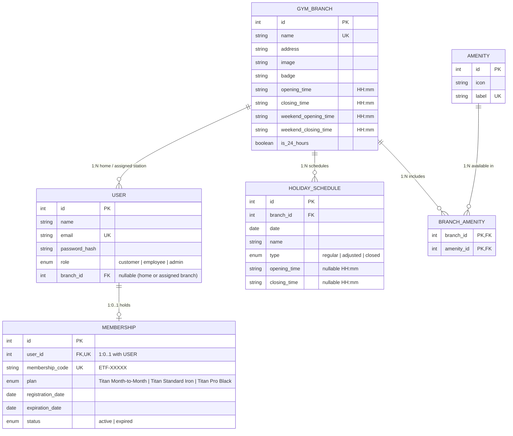

# Entity-Relationship Diagram (ERD) — Earth-Titan Fitness

This ERD defines the PostgreSQL relational schema for **Earth-Titan Fitness** (Milestone 2 — Prisma + NestJS), extending [`PROPOSAL.md`](./PROPOSAL.md) and [`api-contract.md`](./api-contract.md) with normalized `1:0..1`, `1:N`, and `N:N` relationships.

---

## 1. Visual ERD (Mermaid)



---

## 2. Box & Key Diagram (`1:0..1`, `1:N`, and `N:N` Lines)

```text
+-------------------------------+          1 : 0..1          +-------------------------------+
|             USER              |--------------------------->|          MEMBERSHIP           |
+-------------------------------+                            +-------------------------------+
| PK  id                  (INT) |                            | PK  id                  (INT) |
|     name            (VARCHAR) |                            | FK  user_id      (INT, UNIQUE)|
| UK  email           (VARCHAR) |                            | UK  membership_code (VARCHAR) |
|     password_hash   (VARCHAR) |                            |     plan               (ENUM) |
|     role               (ENUM) |                            |     registration_date  (DATE) |
| FK  branch_id (INT, NULLABLE) |                            |     expiration_date    (DATE) |
+-------------------------------+                            |     status             (ENUM) |
                ^                                            +-------------------------------+
                |
                | 1 : N  (One branch is the home / assigned station for many users)
                |
+-------------------------------+          1 : N             +-------------------------------+
|          GYM_BRANCH           |--------------------------->|       HOLIDAY_SCHEDULE        |
+-------------------------------+                            +-------------------------------+
| PK  id                  (INT) |                            | PK  id                  (INT) |
| UK  name            (VARCHAR) |                            | FK  branch_id           (INT) |
|     address         (VARCHAR) |                            |     date               (DATE) |
|     image           (VARCHAR) |                            |     name            (VARCHAR) |
|     badge           (VARCHAR) |                            |     type               (ENUM) |
|     opening_time    (VARCHAR) |                            |     opening_time    (VARCHAR) |
|     closing_time    (VARCHAR) |                            |     closing_time    (VARCHAR) |
|     weekend_opening (VARCHAR) |                            +-------------------------------+
|     weekend_closing (VARCHAR) |
|     is_24_hours     (BOOLEAN) |
+-------------------------------+
                |
                | 1 : N
                v
+-------------------------------+                            +-------------------------------+
|        BRANCH_AMENITY         |          N : 1             |            AMENITY            |
|      (N : N Join Table)       |<---------------------------|                               |
+-------------------------------+                            +-------------------------------+
| PK,FK branch_id         (INT) |                            | PK  id                  (INT) |
| PK,FK amenity_id        (INT) |                            |     icon            (VARCHAR) |
+-------------------------------+                            | UK  label           (VARCHAR) |
        (Resolves N : N between GYM_BRANCH and AMENITY)      +-------------------------------+
```

---

## 3. Relationships & Cardinality Explanation

| Relationship                        | Cardinality                         | Keys Involved                                                            | Rule in Earth-Titan Fitness                                                                                                                            |
| ----------------------------------- | ----------------------------------- | ------------------------------------------------------------------------ | ------------------------------------------------------------------------------------------------------------------------------------------------------ |
| **`User` ↔ `Membership`**           | **`1 : 0..1`** (One-to-Zero-or-One) | `Membership.user_id` (`FK`, `UNIQUE` → `User.id`)                        | Each customer has at most one active/expired membership record; employees and admins have zero memberships.                                            |
| **`GymBranch` → `User`**            | **`1 : N`** (One-to-Many)           | `User.branch_id` (`FK`, nullable → `GymBranch.id`)                       | **One** branch serves as the home registered branch or staff duty station for **many** users, while each user has at most one primary/assigned branch. |
| **`GymBranch` → `HolidaySchedule`** | **`1 : N`** (One-to-Many)           | `HolidaySchedule.branch_id` (`FK` → `GymBranch.id`, `ON DELETE CASCADE`) | **One** gym branch has **many** national holiday schedule overrides (`regular`, `adjusted`, or `closed`).                                              |
| **`GymBranch` ↔ `Amenity`**         | **`N : N`** (Many-to-Many)          | `BranchAmenity(branch_id, amenity_id)` composite `PK` + `FK`s            | **One** branch offers **many** amenities (e.g., _Powerlifting Pods_, _Olympic Platforms_), and **one** amenity is available across **many** branches.  |
